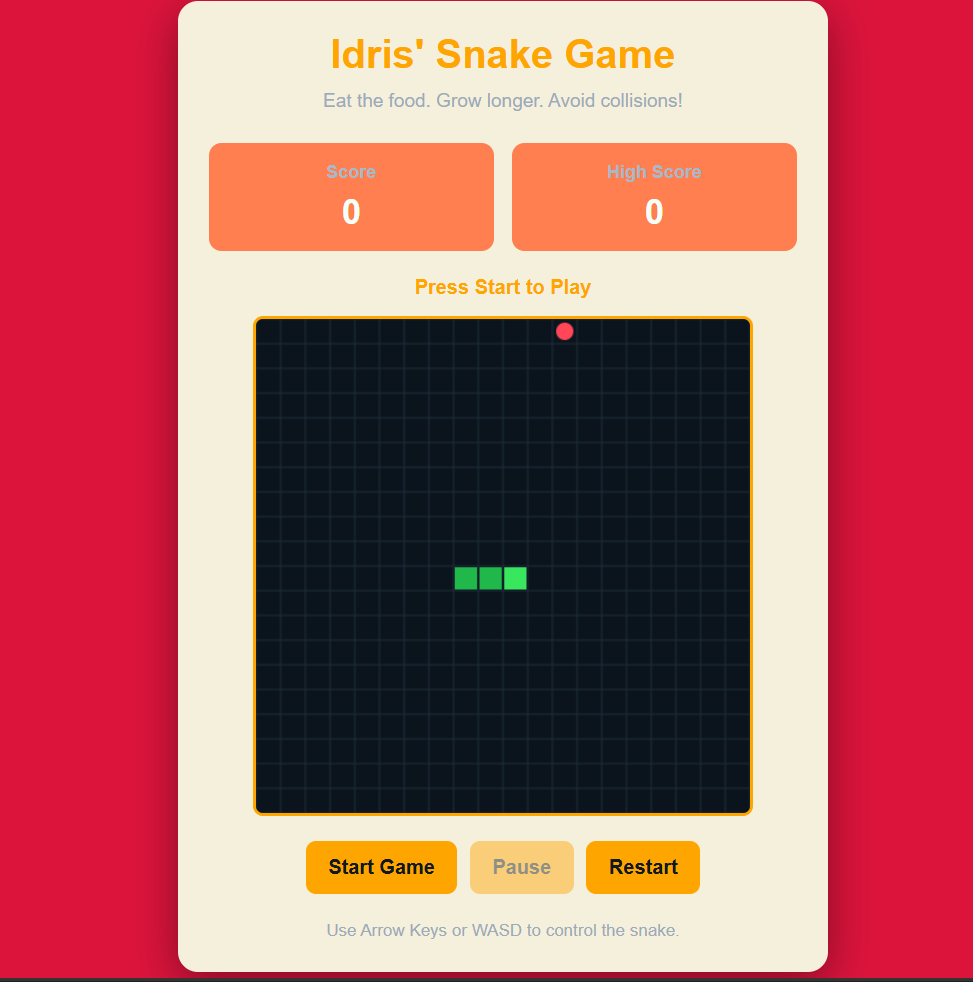

# 🐍 Snake Game

A simple Snake Game built with HTML, CSS and JavaScript.


This project is my attempt to recreate the classic Snake Game that many of us have played before. The idea is simple: control the snake, eat the food, and try not to crash into the walls or your own body.

I built this project to practise JavaScript and get more comfortable working with HTML Canvas, event listeners and game logic.

## What the game can do

- Move the snake using the arrow keys or WASD.
- Eat food and watch the snake grow.
- Keep track of your current score.
- Save your highest score in the browser.
- Pause and restart the game.
- Detect when the snake hits a wall or itself.
- Play using the direction buttons on smaller screens.

## Built with

- **HTML5** – for the structure of the game.
- **CSS3** – for the layout and styling.
- **JavaScript** – for the game logic.
- **Canvas API** – for drawing the snake, food and game board.
- **Local Storage** – for keeping the high score.
- **Git and GitHub** – for version control and project hosting.

## Project structure

```text
SnakeGame/
│
├── index.html
├── style.css
├── script.js
├── screenshots/
├── README.md
├── LICENSE
```

## Running the game locally

1. Clone the repository:

   ```bash
   git clone https://github.com/Tchoffo-idris/SnakeGame.git
   ```

2. Open the project folder:

   ```bash
   cd snake-game
   ```

3. Open the folder in VS Code.
4. Open `index.html` in your browser. You can also use the Live Server extension.

That's it. Click **Start Game** and play.

## How to play

The goal is to eat as much food as possible without hitting the walls or running into yourself.

| Key | Movement |
|---|---|
| ↑ or W | Up |
| ↓ or S | Down |
| ← or A | Left |
| → or D | Right |

Each time the snake eats food, it gets longer and your score increases. Try to beat your previous high score!

## Screenshots

### Game interface



## References

I also looked at examples of the classic Snake Game to understand its gameplay and basic mechanics.

- [Snake Game – YouTube gameplay reference](https://www.youtube.com/watch?v=ydGMG79nyq4)
- [Try Google's Snake Game](https://www.google.com/fbx?fbx=snake_arcade)

## Live demo

The game is live at :
[Snake Game](https://tchoffo-idris.github.io/SnakeGame/)
## What I learned

While working on this project, I got to practise:

- Working with JavaScript arrays and objects.
- Drawing and updating objects on an HTML Canvas.
- Handling keyboard and button events.
- Generating random positions for food.
- Checking for collisions.
- Using Local Storage to save data.
- Organising a project into separate files.
- Using Git to track changes.

There were a few things to figure out along the way, especially how to control the snake's movement and detect collisions correctly. Those parts helped me understand the game logic better.

## About

**Tchoffo Idris**  
Computer Networking and Security Student

[GitHub Profile](https://github.com/Tchoffo-idris)

---
